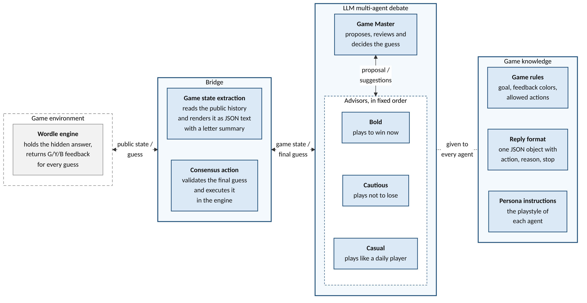
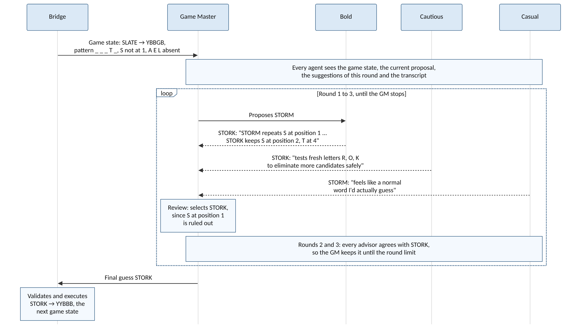
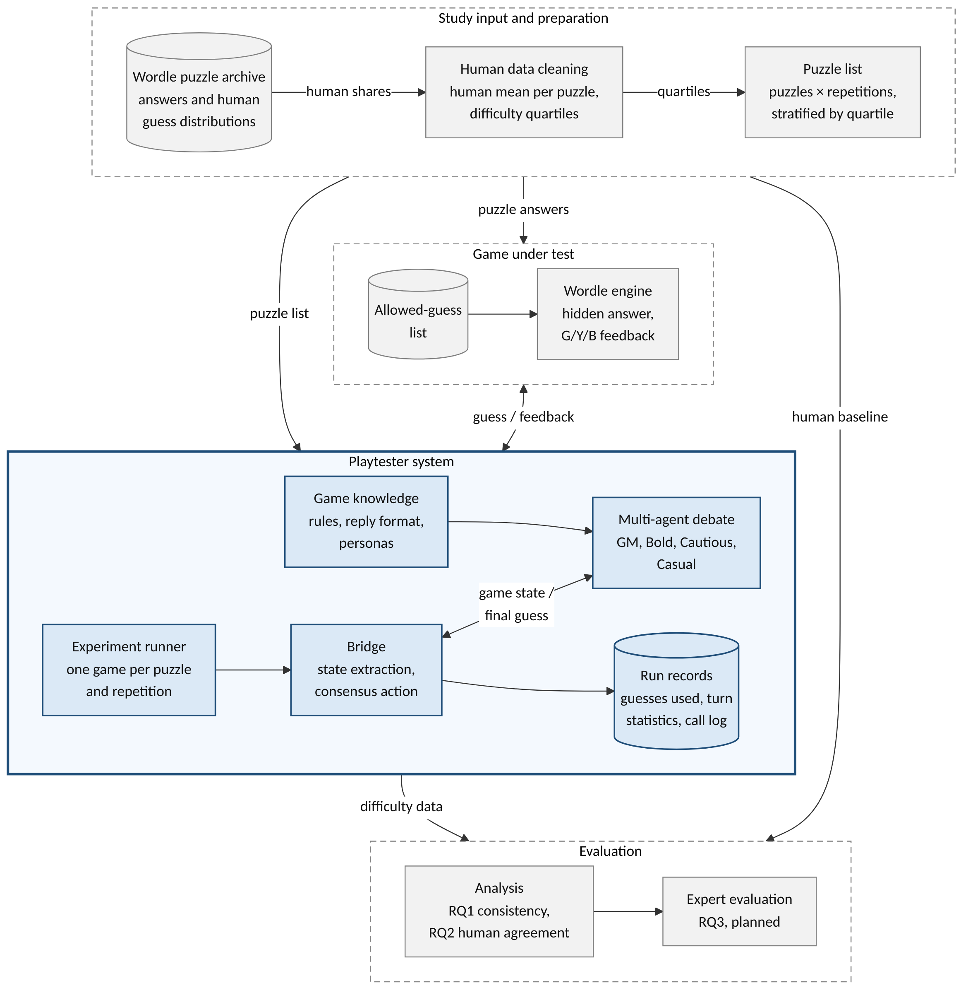
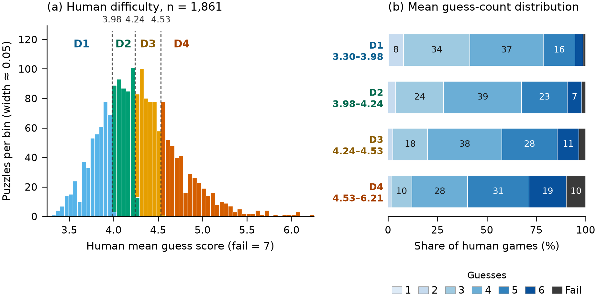
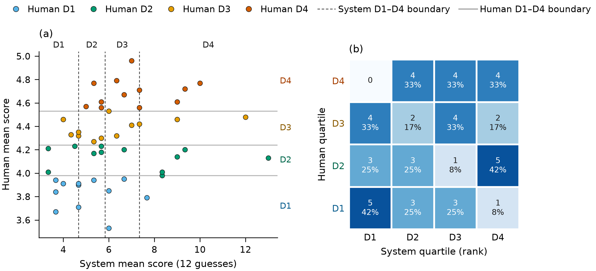

# THESIS PROGRESS REPORT

(Reported on 10/22/2026)

**Persona-Based Multi-Agent LLM Debate as an Automated Playtester: Validating Game Difficulty Data Against Human Performance Baselines**

Submitted by: **Muhammad Haydar Maulana [203012510020]**

Concentration: **Informatics Software Engineering**

E-mail: **haydariday@gmail.com**

Approved by:

- Supervisor (I): Dr. Arfive Gandhi S.T., M.T.I.
- Supervisor (II): Dr. Eng. Jati Hiliamsyah Husen S.T., M.Eng.

---

## Progress Summary

This research develops a persona-based multi-agent large language model (LLM) debate framework that acts as an automated playtester for game difficulty. The scope was narrowed to fit a research period of less than one year. The study now uses Wordle as its only case study, while Slay the Spire and the single-agent comparison were moved out of scope. The first research question (RQ1) asks how consistent the playtester's outcomes are across repeated runs, while RQ2 asks how well they agree with human difficulty. RQ3 is unchanged and asks how industry experts evaluate the utility and efficacy of the playtester.

The playtester is implemented in Python with LangGraph. A Game Master (GM) agent proposes each guess, after which Bold, Cautious and Casual advisor agents critique it from their own playstyles. The GM then keeps or revises its guess until it stops the debate or reaches three rounds. A bridge renders only the public game feedback for the agents, so the answer word and the human scores never appear in any prompt. Every call, decision and turn is logged for later analysis. A resumable runner records the configuration, code revision and data hashes of each experiment.

A pilot study has been completed. It uses playstyle personas while drawing its puzzles evenly from four difficulty quartiles, which are based on 1,861 cleaned human puzzles. Its configuration ran on DeepSeek-V4.1-Flash at temperature 0.2 with a hidden limit of 12 guesses, following the handicap of Xiao and Yang [1]. The pilot completed 525 games over 60 puzzles in two experiments. The deep experiment plays 12 puzzles 32 times each for RQ1, while the wide experiment plays 48 puzzles three times each for RQ2.

The early results are mixed. A single run is only moderately consistent, with an intraclass correlation (ICC) of 0.49, yet the mean of 32 runs is highly reliable, with an ICC of 0.97. The playtester ranks puzzles in the same direction as humans (Spearman ρ = 0.34 on 48 puzzles, 0.72 on 12 puzzles) while playing about 1.3 guesses worse than human players. Because of this bias, the playtester measures relative difficulty better than absolute difficulty.

Three steps remain. First, the pilot results will be used to size the final study and to fix its consistency margin before any final run. Second, the expert evaluation for RQ3 will follow the quantitative analysis. Third, the findings are being written up as a conference paper, of which chapters 1 and 2 are drafted.

### Previous revisions

| Comments/Feedback from Reviewers | Updates |
|---|---|
| - | Title changed from "Multi-Agent LLM Debate for Consensus-Based Difficulty Assessment in Automatic Playtesting" to "Persona-Based Multi-Agent LLM Debate as an Automated Playtester: Validating Game Difficulty Data Against Human Performance Baselines". |
| - | Scope narrowed to Wordle only. Slay the Spire and the single-agent comparison were removed. |
| - | Personas changed. The Negative and Positive advisors were replaced by the Bold, Cautious and Casual playstyle advisors. |

---

## 1. Background

"Is the game hard enough for the intended player?" is one of the key questions that game designers keep asking during development [2]. A game that is too hard drives players away while one that is too easy soon becomes stale, both of which risk losing players and receiving a negative reception [3]. That is why difficulty can be an indicator of player engagement and experience [4], [5]. Designers measure this difficulty through playtesting. However, manual playtesting is resource-intensive since it needs many testers over many sessions and has to be repeated after every significant design change [2], [6], [7]. For indie game developers with limited budgets, this cost is often prohibitive.

Automatic playtesting has gained popularity among industry and academic researchers alike. Hand-crafted methods, such as programmed test agents [6] and mathematical difficulty models [8], require heavy engineering effort for each game or genre. Learning-based methods such as deep reinforcement learning need large training resources while also tending to play in ways that humans would not [9]. Large Language Models (LLMs) provide an alternative, as LLM agents can play games ranging from chess [10] to Pokémon battles [11] and Minecraft [12] using only a text description of the rules. Xiao and Yang [1] show that the difficulty LLM agents experience in Wordle and Slay the Spire follows that of human players, even though the agents play worse.

However, these LLM playtesters rely on a single agent that plays with only one playstyle. Human players are more diverse, as some take risks while others play safely. Moreover, single LLMs replicate human strategic behavior less closely than multi-agent systems do [13]. Multi-agent debate could reconcile several playstyles into one consensus action, yet such consensus frameworks remain absent from current difficulty measurement methods. Thus, it remains unclear whether an LLM playtester can produce difficulty data that is both consistent and aligned with human players once multiple playstyles are considered.

Two conditions must hold before such a playtester can be used. First, its outcomes must be consistent across runs. Since LLM outputs vary between calls, the same puzzle can end differently on different runs, which leaves a designer with little to rely on. Xiao and Yang [1] play each Wordle puzzle 20 times yet report only the average outcome, so this consistency is still unknown. Second, its outcomes must agree with human difficulty, because a consistent playtester that finds every puzzle equally easy is still of no use. Moreover, whether such a playtester gives actionable insights to game designers remains an open question that requires expert validation.

To accommodate this gap, we establish a persona-based multi-agent LLM debate framework that acts as an automated playtester. Game difficulty here refers to objective difficulty, which is measured from play outcomes rather than from the perceptions of individual players [14]. We employ Wordle as the case study since its games are short with deterministic feedback. It was also studied by Xiao and Yang [1] while having public human results for each puzzle. If the playtester meets both conditions, indie game developers gain a cheaper source of difficulty data that still reflects human players.

## 2. Objective and Hypotheses

### 2.1 Research questions

- **RQ1.** How consistent are the Wordle playtest outcomes produced by the persona-based multi-agent debate playtester across repeated runs on the same puzzles?
- **RQ2.** To what extent do the Wordle difficulty estimates derived from the playtester's outcomes agree with human difficulty, measured by average guess scores and difficulty categories?
- **RQ3.** How do industry experts evaluate the utility and efficacy of multi-agent LLM debate for automated difficulty testing?

### 2.2 Objectives

The objectives of this research are threefold:

1. To implement a multi-agent LLM debate framework that operationalizes difficulty measurement through diverse personas, transforming point estimates into consensus-based assessments, with Wordle as the case study.
2. To evaluate the consistency of the framework's outcomes across repeated runs and validate their agreement with human performance baselines, which answers RQ1 and RQ2.
3. To gather expert evaluations regarding the utility and efficacy of the multi-agent debate methodology for automated difficulty assessment in game development workflows, which answers RQ3.

### 2.3 Hypotheses

The pilot study is descriptive, so H1 and H2 are tested only in the final study. H3 is tested through the expert evaluation.

- **H1.** The playtester produces consistent outcomes, as its within-puzzle standard deviation stays below a margin that is fixed from the pilot results before the final run.
- **H2.** The playtester ranks puzzles in the same order of difficulty as human players do, while its difficulty categories agree with the human categories beyond chance.
- **H3.** Industry experts will evaluate the multi-agent debate framework as viable for automated playtesting.

### 2.4 Method and concept

The framework combines two lines of work. It takes playstyle personas from persona-based playtesting [15] while taking the consensus process from multi-agent debate [16]. Both are then applied to the LLM difficulty measurement of Xiao and Yang [1]. Unlike that work, which uses one agent, our playtester lets several agents with different playstyles decide each guess together. Unlike studies that compare multi-agent systems with a single agent [13], [17], this research validates the playtester as a system rather than claiming that debate beats a single agent.

## 3. Research Method

### 3.1 Existing software/system/method

Hand-crafted playtesters are highly controlled but must be rebuilt for each game. Prasetya et al. [6] build test agents with goal structures in the APLib framework, which requires significant programming effort with a steep learning curve. The mathematical model of Francillette et al. [8] needs no sophisticated AI, yet it is limited to platformer games while demanding a complex setup.

Learning-based playtesters reduce part of this manual work. Gudmundsson et al. [18] train a deep neural network on human moves, after which it predicts how hard new levels are for players. However, such an agent can only be used once a large set of human play data is available. Deep reinforcement learning agents learn from their own play instead, yet they demand substantial training resources while lacking the behavioral patterns of human players [9]. Holmgård et al. [15] represent different playstyles through procedural personas, although each persona still relies on heuristics evolved for the specific game.

LLM playtesters can play a new game from its rules alone. Zhao and Tang [7] test match-3 games by converting the board into numerical text, while Bateni and Whitehead [19] show long-term planning in Slay the Spire without specialized training. Xiao and Yang [1] measure the difficulty of Wordle and Slay the Spire with a single LLM agent, which loses too often unless a handicap is added. MIMIC [20] gives an LLM game tester different personality traits, which leads to more diverse solutions. For combining agents, multi-agent debate lets agents revise their answers over several rounds until they agree [21]. Liang et al. [16] add a managing agent that oversees the exchange to obtain the final decision. However, the benefit of debate depends strongly on how it is set up [17], while agents may also drift from their assigned personas [22].

### 3.2 Software/system/method requirement specification

#### 3.2.1 Features

The system must do the following things. First, it must support multiple agents working together within a debate loop. Second, it must pull game state data from Wordle and turn that structured data into text that the LLM can read. Third, the Agents must have different personas or strategic viewpoints so that the debate produces diverse opinions rather than everyone agreeing immediately. Fourth, the Game Master agent must be able to stop the debate when enough perspectives have been heard and finalize the consensus action. Fifth, the system must translate the finalized consensus action into a format that the game engine can process and execute it directly within the game environment. Sixth, every model call, debate decision and game outcome must be logged so that the agreement analysis can be done later.

#### 3.2.2 LLM Integration

The framework needs a large language model that can handle complex reasoning and long conversations. The main contenders were DeepSeek and ChatGPT (OpenAI's GPT series), from which the research now uses DeepSeek-V4.1-Flash. It was chosen since it allows a fixed temperature once its thinking mode is disabled, while its cost per game stays low. The chosen model must handle three basic things well. First, it must be good at multi-step reasoning, because the agents need to think through game states and argue back and forth. Second, its input limit must fit the game rules, the game state and the full debate history of a turn. Third, the model must return valid replies reliably, since an invalid reply has to be corrected while a failed game has to be played again. The tokens and time of every model call are recorded so that the expense of the multi-agent approach can be reported.

#### 3.2.3 Participants

For the expert evaluation in RQ3, the participants must work in game development as game designers, quality assurance (QA) testers or producers. In addition, they must have dealt with difficulty balancing or player experience in their work. They need at least three years of industry experience, while it is preferred if they have worked on puzzle, strategy or roguelike games like Wordle and Slay the Spire. The plan is to recruit five to seven experts through professional networks or game development communities. All participants will give informed consent, while their names and responses will be kept anonymous. This ensures that the evaluators know enough about real game development to judge whether the framework would be useful in practice.

### 3.3 Design of the software/system/method

#### 3.3.1 Playtester framework

Figure 1 shows the playtester framework, which has three parts around the game environment: the bridge, the multi-agent debate and the game knowledge. In each turn, the bridge extracts the public game state and converts it into text. Converting the game state into text lets an LLM read a game that it cannot see [7]. The agents then debate the next guess from this state with the game knowledge, beginning with a proposal from the GM. Once the debate ends, the GM decides the final guess, after which the bridge executes it in the game as the consensus action.

*Figure 1. The multi-agent debate playtester framework for Wordle. The game environment is drawn as a dashed box, since it is the game under test.*

#### 3.3.2 Personas

Table 1 lists the four personas of the debate, which are one Game Master (GM) and three advisors. The advisors hold playstyle personas, since the research asks how different players experience the game.

*Table 1. The personas of the debate.*

| Persona | Role | Playstyle |
|---|---|---|
| Game Master | Managing agent | Neutral. Proposes a guess, evaluates every advisor's argument and keeps or revises its proposal. |
| Bold | Advisor | Plays to win now. Prefers guesses that could still be the answer and accepts the risk of using more guesses later. |
| Cautious | Advisor | Plays not to lose. Prefers guesses that rule out the most remaining letters, even if they cannot be the answer. |
| Casual | Advisor | Plays like a typical daily player. Prefers common, familiar words with a habitual opener and does not compute letter statistics. |

Players do not share a single playstyle. The gameplay data of 1,365 players revealed four player types [23], while procedural personas with different goals can act as synthetic playtesters [15]. Wordle is a deterministic single-player game with imperfect information, since the answer is hidden while each guess receives feedback by fixed rules. With no chance to manage, the only decision a player makes is how to spend each guess. A player may exploit by guessing a word that could still be the answer, or explore by guessing a word that mainly rules out letters. This trade-off is a classic problem in human decision making, where people seek more information when more choices remain [24].

The two sides of this trade-off point in opposite directions in Wordle. A more cautious player leans toward exploration, which is also how optimal play works. For instance, the exact solution of Wordle answers the opening LIGHT with FERMS rather than TIGHT or MIGHT [25]. A bolder player, on the other hand, stays close to the words they have already tried, a pattern also found in real Wordle games [26]. Thus, the Bold advisor argues for guesses that could win immediately, while the Cautious advisor argues for guesses that narrow down the remaining words. The Casual advisor adds the typical daily player, who picks familiar words without computing letter statistics.

We use three advisors, one for each playstyle, rather than adding more advisors. Adding debaters can lower performance, since the agents forget the views of others as the debate grows longer [16]. Debates with three agents already show clear gains, while more agents add further gains only at a higher cost [21].

#### 3.3.3 Bridge

The bridge is the interface layer that connects the game environment to the multi-agent debate. It consists of two components:

- **Game state extraction.** It reads the public game state from the Wordle engine, which is the history of guesses with their feedback. Each letter of a guess turns green in its correct position, yellow when it belongs elsewhere in the word and gray when the word lacks it. This state is converted into JSON text that holds the game rules, the guess history and a keyboard-style letter summary. The answer word and the guess limit are left out, so the agents play the first six guesses the same way under any guess limit (see Section 3.4).
- **Consensus action.** It receives the final guess of the GM once the debate ends. The bridge checks that the guess is a word from the 14,855-word allowed-guess list that has not been played before, after which it executes the guess in the engine. This list holds every word that Wordle accepts as a guess, as extracted from the source code of the game [27]. The resulting feedback becomes the game state of the next turn.

The letter summary plays the role of the colored keyboard that a human player sees. It lists the confirmed positions, the misplaced letters and the absent letters, without any list of candidate words. For example, the summary after SLATE with the feedback YBBGB (yellow, gray, gray, green, gray) shows the pattern `_ _ _ T _`. It also marks S as misplaced at position 1, while A, E and L are listed as absent.

#### 3.3.4 Debate protocol

In the protocol, a managing agent oversees a reciprocal exchange between the other agents [16]. First, the GM proposes a guess. Second, each advisor reads the GM proposal with the suggestions of the earlier advisors, after which it agrees or suggests a different word with a short reason. The advisors speak in the fixed order of Bold, Cautious and Casual in every round. Third, the GM reviews every suggestion and keeps or revises its guess. A new round skips the proposal and starts again from the first advisor.

Every agent receives the same input, which holds the game state, the current proposal, the suggestions of this round, the debate transcript and its own task for this step. Rather than forcing a fixed number of rounds, the debate uses an adaptive break. The GM may stop after its review when another round is unlikely to change its decision, while three rounds is the upper limit [16]. A higher limit would raise the cost of each game, since each extra round adds four model calls to every turn. Every reply is a JSON decision with an action, a reason and a stop flag. An invalid reply, such as a word outside the allowed-guess list, is sent back with a request to correct it, up to two times within the same turn.

Figure 2 shows a real turn from the pilot, in which the GM first proposes STORM although S is already ruled out at position 1. Bold and Cautious both point this out and suggest STORK, while Casual agrees with STORM because it feels like a normal word. The GM adopts STORK, after which every advisor agrees with it in the next two rounds before it is played.

*Figure 2. The debate protocol in the second turn of a pilot game. The quotes are shortened from the logged replies.*

#### 3.3.5 Game knowledge

The game knowledge is the static information that every agent receives with its prompt. First, the game rules state the goal of guessing the hidden five-letter word, the meaning of each feedback color and the allowed actions. Second, the reply format asks for one JSON object with an action, a reason and a stop flag, which keeps every decision machine-readable. Third, the persona instructions give each agent its role and playstyle. The playing strategy is therefore not shared among the agents, since each advisor carries its own strategy through its persona.

#### 3.3.6 Turn statistics

Each turn logs the GM's first proposal, the final guess and every advisor suggestion. It also logs whether each word could still be the answer given the public feedback. These fields record how the consensus was reached in every turn.

These fields also check whether the personas behave as intended. Persona prompts can improve LLM game play only when a mediator translates them into heuristic values [28]. Moreover, agents in a debate may drift from their assigned personas [22]. Thus, the Cautious advisor should suggest words that cannot be the answer more often than the Bold advisor does.

### 3.4 Experiment design

#### 3.4.1 Study pipeline

Figure 3 shows the study pipeline, which is how the data flows from the study inputs to its outputs. The playtester system is the solid box in the middle, while the dashed boxes are the study steps and the game around it.

The study starts from the Wordle puzzle archive of Engaging Data [29]. It gives the answer of each daily puzzle with the share of players who solved it in 1 to 6 guesses. The answers go only to the game under test, while the human shares go to the human data cleaning step. This step computes the human mean of each puzzle and sorts the puzzles into four difficulty quartiles, which are four equal groups from the easiest to the hardest puzzles. A puzzle list then selects the puzzles of each experiment evenly from these quartiles, while setting how many times each puzzle is played.

{width=4.8in}

*Figure 3. The study pipeline from the input to the output. The solid box is the playtester system, while the dashed boxes are the study steps and the game around it.*

The playtester system takes this puzzle list as its only input, after which the experiment runner plays each puzzle and repetition as a separate game. In each game, the bridge and the multi-agent debate play against the Wordle engine turn by turn. Every game ends as a run record with the number of guesses used, the debate of every turn and the log of every model call. These run records are the difficulty data that the playtester delivers to a game designer.

The evaluation lies outside the playtester, where the analysis compares the run records with the human baseline to answer RQ1 and RQ2. Game difficulty can be measured in this way, by comparing the outcomes of LLM agents with human results [1]. The expert evaluation for RQ3 is planned for the next stage of the research. Since the answer word and the human scores never enter an agent prompt, the playtester cannot copy the difficulty that it is measured against.

#### 3.4.2 Human data

The human baseline comes from the Engaging Data Wordle guess distribution [29], which gives the share of players who solved each puzzle in 1 to 6 guesses. The remaining share is treated as a loss, which is scored as 7. Each puzzle therefore has a 7-bin distribution, which is the share of players in each of the seven outcomes. Since the guess count is a play outcome rather than a perception, it measures objective difficulty [14]. Four puzzles are removed for data errors, such as a missing sample size or an implausible solved share, which leaves 1,861 of 1,865 puzzles. The puzzles are sorted by their human mean and split into four equal quartiles, D1 (easiest) to D4 (hardest), with cut-points of 3.98, 4.24 and 4.53 guesses. A cut-point is the human mean at which one quartile ends and the next begins. These cut-points were frozen before any pilot run. Figure 4 shows these quartiles, where the two middle quartiles span only 0.55 guesses.

*Figure 4. Human difficulty of the 1,861 cleaned puzzles. (a) The number of puzzles at each human mean, where the dashed lines mark the cut-points of the four quartiles. (b) The mean share of human games that ended in each number of guesses or a loss, by quartile.*

#### 3.4.3 Pilot design

The pilot splits its games into two experiments, since consistency is measured over repeated runs of the same puzzle while agreement with humans is measured across puzzles. Exp A (deep) answers RQ1, while Exp B (wide) answers RQ2 through the average scores and difficulty categories. Exp A also serves as a second check of RQ2, since its puzzle means rest on many games. Moreover, only Exp A has enough runs per puzzle for the 7-bin distribution comparison. Table 2 summarizes both experiments.

*Table 2. The two experiments of the pilot.*

| | Exp A (deep) | Exp B (wide) |
|---|---|---|
| Puzzles | 12 (3 per quartile) | 48 (12 per quartile) |
| Runs per puzzle | 32 | 3 |
| Sampling | Stratified random, seed 20261013 | Stratified random, seed 20261014, disjoint from Exp A |

The two sizes follow two different rules. For Exp A, the number of runs follows Thompson's rule for estimating a distribution [30]. This rule keeps all seven shares of a puzzle within a margin of their true values together. Thirty-two runs keep every share within 20 percentage points at 95% confidence, which shows the shape of each distribution. This is enough to compare distributions across puzzles, while a claim about a single puzzle would need more runs. For Exp B, twelve puzzles per quartile follow the rule of thumb of 12 units per group for a pilot study [31]. A game that fails, such as when an agent keeps giving invalid replies, is retried once, while only completed games are analyzed.

**Configuration.** The pilot uses one configuration, which was frozen before its runs started. Every agent runs on DeepSeek-V4.1-Flash with its thinking mode disabled, temperature 0.2 and a 1,024-token reply limit. The configuration allows 12 guesses. The agents never see the limit, so the first six guesses play the same as under the normal rule of six guesses. This 12-guess limit is a handicap that keeps the hard puzzles apart, since a 6-guess limit would tie them at a score of 7 [1]. Each game is thus read on two scores, a 12-guess score where a loss scores 13 and a 6-guess score capped at 7 as in the human data. The text and the categories use the 12-guess score, while the bias and the MAE use the 6-guess score.

#### 3.4.4 Measures

For RQ1, the within-puzzle standard deviation (SD) is the spread of guess counts over the runs of a puzzle, averaged over the puzzles. The intraclass correlation (ICC) is the share of score variation that comes from the puzzle rather than from run-to-run noise. It is given for a single game as ICC(1,1) and for the mean of all k runs as ICC(1,k).

For RQ2, Pearson r measures how closely the playtester's averages follow the human averages, while Spearman ρ checks only whether the two orders of difficulty match. Both are reported with their p-values and read as very weak below 0.2, weak to 0.4, moderate to 0.6 and strong above it [1]. The bias is the mean difference from the human average, while the mean absolute error (MAE) is the mean distance from it. Higher values are better for the ICC and the correlations, while values closer to zero are better for the SD, the bias and the MAE.

The difficulty categories are formed by rank, as the playtester's means are split into four equal groups like the human quartiles. A confusion matrix counts the puzzles placed in their human quartile or in a neighboring one.

## 4. Experiment result

### 4.1 Completion and cost

The pilot made 543 attempts, of which 525 ended as completed games. Exp A completed 383 of its 395 attempts, while Exp B completed 142 of its 148. Of the 18 failed attempts, 13 ended because an agent still gave an invalid reply after two correction requests. In Exp A, four more attempts were cut off when a run was stopped, while one ended on a timeout of the model service. After the retries, 11 of the 12 Exp A puzzles and 46 of the 48 Exp B puzzles reached all of their planned runs.

On average, a game took 71 seconds in Exp A with 75,800 prompt and 3,900 completion tokens. A game in Exp B took 67 seconds with 84,800 and 4,300 tokens. Every answered call returned the same model version identifier. The GM ended the debate itself in 57 of the 2,198 turns of Exp A and in 19 of the 887 turns of Exp B. Every other turn ran to the limit of three rounds.

### 4.2 RQ1 results

In Exp A, a single game gave an ICC(1,1) of 0.49, while the mean of 32 games reached an ICC(1,k) of 0.97. Table 3 reports the RQ1 measures of both experiments. Table 4 breaks the within-puzzle SD down by human quartile. On the 12-guess score, the mean SD of Exp A rose from 0.94 guesses for D1 puzzles to 2.30 for D4 puzzles. On the 6-guess score, it stayed between 0.74 and 1.10 guesses.

*Table 3. RQ1 measures of Exp A (12 puzzles × 32 runs) and Exp B (48 puzzles × 3 runs) on the 12-guess and 6-guess scores. Bold marks the best value in each row, which is the lowest SD or the highest ICC.*

| | Exp A, 12-guess | Exp A, 6-guess | Exp B, 12-guess | Exp B, 6-guess |
|---|---|---|---|---|
| Within-puzzle SD (guesses) | 1.53 | 0.96 | 1.52 | **0.85** |
| ICC(1,1), one game | 0.49 | **0.55** | 0.48 | 0.44 |
| ICC(1,k), mean of all runs | 0.97 | **0.98** | 0.73 | 0.70 |

*Table 4. Mean within-puzzle SD (guesses) by human quartile on the 12-guess and 6-guess scores. Bold marks the lowest SD in each row.*

| Human quartile | Exp A, 12-guess | Exp A, 6-guess | Exp B, 12-guess | Exp B, 6-guess |
|---|---|---|---|---|
| D1 | 0.94 | **0.74** | 1.06 | 0.89 |
| D2 | 1.37 | 1.10 | 1.75 | **0.78** |
| D3 | 1.48 | 0.95 | 1.35 | **0.79** |
| D4 | 2.30 | 1.04 | 1.93 | **0.95** |

### 4.3 RQ2 results

Table 5 reports the RQ2 results of both experiments in the format of Xiao and Yang [1]. The bias and the MAE are given on the 6-guess score only, as the human data ends at six guesses. On the 6-guess score, the playtester averaged more guesses than humans on 42 of the 48 Exp B puzzles and on 11 of the 12 Exp A puzzles. It also lost 30.5% of its Exp A games within six guesses, while humans lost 3.8% of theirs.

*Table 5. RQ2 results of Exp B (48 puzzles × 3 runs) and Exp A (12 puzzles × 32 runs) on the 12-guess and 6-guess scores, with p-values for the correlations. Bold marks the best value in each measure row, which is the highest correlation or the lowest bias and MAE.*

| | Exp B, 12-guess | Exp B, 6-guess | Exp A, 12-guess | Exp A, 6-guess |
|---|---|---|---|---|
| Playtester avg. guesses | 6.34 | 5.54 | 5.76 | 5.29 |
| Human avg. guesses | 4.26 | 4.26 | 4.25 | 4.25 |
| Pearson r | 0.30 (p = 0.039) | 0.38 (p = 0.007) | **0.70** (p = 0.011) | 0.60 (p = 0.041) |
| Spearman ρ | 0.34 (p = 0.017) | 0.36 (p = 0.012) | **0.72** (p = 0.008) | 0.62 (p = 0.031) |
| Bias (guesses) | – | +1.28 | – | **+1.04** |
| MAE (guesses) | – | 1.38 | – | **1.26** |

Figure 5 compares the difficulty categories of the 48 Exp B puzzles, with the playtester's means split by rank. In Figure 5a, each dot is a puzzle, while the dashed lines mark the playtester's quartiles and the gray lines mark the human quartiles. Figure 5b counts the same puzzles, with each row as a human quartile and each column as the quartile that the playtester assigns. Here 16 of the 48 puzzles fell on the diagonal, while 31 lay in the same or a neighboring quartile. The largest miss was a group of five human D2 puzzles that the playtester placed in D4, while no human D4 puzzle was placed in D1.

*Figure 5. Difficulty categories of the 48 wide puzzles in Exp B, with the playtester's means split by rank. (a) The playtester's mean of each puzzle against its human mean. (b) The same puzzles as a confusion matrix, where each cell gives the number of puzzles with its share of the human quartile.*

## 5. Analysis of the experiment result

The pilot is descriptive, so the results below are estimates rather than tests of a fixed target.

### 5.1 RQ1: consistency

A single run of the playtester is only moderately consistent. Its ICC(1,1) of 0.49 means that about half of the score variance lies between puzzles, while the rest comes from run-to-run noise. Moreover, the guess count of a puzzle varied by about 1.5 guesses from game to game (Table 3). However, the mean over many runs is highly reliable, as the ICC(1,k) of 0.97 for 32 runs shows. Even the mean of three runs in Exp B reaches an ICC(1,k) of 0.73. That is why a puzzle should be played several times before its mean is used as difficulty data. Part of this spread comes from the hard puzzles, which produce long games and occasional losses. The ICC also needs differences between puzzles, which a playtester that wins every game in few guesses could not show.

### 5.2 RQ2: agreement with human difficulty

The playtester ranks puzzles in the same direction as humans, since both rank correlations are positive with a p-value below 0.05. The ranking is stronger in Exp A (ρ = 0.72) than in Exp B (ρ = 0.34), as 32 runs give a more precise mean than three. The Pearson r of 0.70 in Exp A is comparable to the best r of 0.62 that Xiao and Yang [1] report with 20 runs per puzzle. However, the playtester plays about 1.3 guesses worse than human players. Part of this gap comes from losses, as the playtester lost 30.5% of its Exp A games within six guesses against 3.8% for humans. With so many games ending at a score of 7, a 6-guess limit would tie the hard puzzles, which is why the 12-guess limit keeps them apart. The MAE of 1.38 guesses is more than twice the width of the middle two quartiles, which span only 0.55 guesses between the cut-points of 3.98 and 4.53. Thus, the playtester's scores cannot be read directly on the human scale, while an MAE close to the bias shows that most of this error is a constant shift. That is why the difficulty categories are formed by rank rather than by the human cut-points. These categories match the human quartiles only slightly better than random guessing. A random pick would place one in four puzzles in their human quartile and five in eight in the same or a neighboring one. The second share is larger since D2 and D3 have two neighbors while D1 and D4 have one. In Exp B, the playtester gave 16 of the 48 puzzles the same category as humans, while random guessing would match about 12. It placed 31 puzzles in the same or a neighboring category, which is close to the 30 that random guessing would reach. These results suggest that the playtester measures relative difficulty better than absolute difficulty. The final study will therefore judge agreement mainly through ranks.

### 5.3 RQ3: expert evaluation (planned)

The expert evaluation has not started, since it follows the quantitative analysis in the research schedule. It combines a Likert-scale survey with semi-structured interviews. In the survey, the experts rate utility statements on a scale of 1 to 5, after which the overall average score is reported. The interviews are then analyzed thematically, while each recurring theme is reported as a share of the expert pool. The experts will see the final RQ1 and RQ2 results, so they can judge whether such difficulty data would be useful in their own workflows.

### 5.4 Implications for the final study

The pilot results will fix the final design before any final run. First, the number of runs per puzzle will be set so that the puzzle mean reaches a reliability target, such as an ICC(1,k) of at least 0.9. Second, the RQ1 margin, for example a within-puzzle SD of at most 0.5 on the 6-guess score, will be chosen from the observed spread. Third, the rank correlation will be the primary RQ2 measure, while the rank-based quartiles will be secondary, since they matched the human ones only slightly better than random guessing. The final study will use three categories instead of four, since the human shares are rounded to whole percents. This rounding leaves the human category of 77% of all puzzles uncertain with four categories, against 63% with three. Fourth, the three easiest and three hardest puzzles by human mean will be shown as a descriptive case study of their guess distributions. The final study will use fresh puzzles that were never played in the pilot.

### 5.5 Threats to validity

Two threats to validity concern the human data. First, the source rounds each share to a whole percent, which can shift the human mean of a puzzle by up to about 0.2 guesses. Under this worst case, 41 of the 48 Exp B puzzles could fall in a neighboring quartile, since D2 and D3 are each less than 0.3 guesses wide. Second, the cut-points describe the Wordle archive only, so other puzzle sets or games may split into quartiles differently. The rank correlation does not depend on these cut-points, which supports its use as the primary RQ2 measure.

## 6. Schedule Realization

The schedule uses months 1 to 12. Realized dates come from the project records.

| Activity | Schedule Start | Schedule End | Realization Start | Realization End | Output Target | Realization |
|---|---|---|---|---|---|---|
| Reference tracing | Month 1 | Month 3 | 09/25/2026 | 10/15/2026 | Literature review and research gap | Done. Conference chapters 1 and 2 drafted. |
| Requirement identification | Month 1 | Month 3 | 09/25/2026 | 10/13/2026 | Requirements, RQs, hypotheses and scope | Done. Scope narrowed to Wordle. |
| Design process | Month 1 | Month 4 | 09/25/2026 | 10/13/2026 | Bridge, debate protocol and data logging | Done. Persona registry and turn statistics added. |
| Implementation process | Month 2 | Month 6 | 10/02/2026 | 10/21/2026 | Wordle prototype | Done. Slay the Spire dropped. |
| Experiment design and plan | Month 1 | Month 6 | 10/13/2026 | Ongoing | Human data, pilot study and final design | Pilot done. Final sizing and expert evaluation design pending. |
| Analysis/Evaluation | Month 5 | Month 8 | 10/13/2026 | Ongoing | Quantitative analysis, expert evaluation and thematic analysis | Pilot analysis and figures done. Final analysis, expert evaluation and thematic analysis not started. |

## References

[1] C. Xiao and Z. Yang, "LLMs may not be human-level players, but they can be testers: Measuring game difficulty with LLM agents," *Proc. ACM Hum.-Comput. Interact.*, vol. 9, no. 6, pp. 1097–1123, Oct. 2025, doi: 10.1145/3748634.  
[2] M. Weber and P. Notargiacomo, "Dynamic difficulty adjustment in digital games using genetic algorithms," in *Proc. 19th Brazilian Symp. Computer Games and Digital Entertainment (SBGames)*, Recife, Brazil, Nov. 2020, pp. 62–70, doi: 10.1109/SBGames51465.2020.00019.  
[3] L. Karavidas, H. Apostolidis, and T. Tsiatsos, "Usability evaluation of an adaptive serious game prototype based on affective feedback," *Information*, vol. 13, no. 9, p. 425, Sep. 2022, doi: 10.3390/info13090425.  
[4] E. A. Romero-Mendez, P. C. Santana-Mancilla, M. Garcia-Ruiz, O. A. Montesinos-López, and L. E. Anido-Rifón, "The use of deep learning to improve player engagement in a video game through a dynamic difficulty adjustment based on skills classification," *Applied Sciences*, vol. 13, no. 14, p. 8249, Jul. 2023, doi: 10.3390/app13148249.  
[5] D. A. Alvarado Villa, O. A. Montesinos López, and P. C. Santana-Mancilla, "Training of an intelligent agent to improve the gaming experience for video gamers," *Avances en IHC*, vol. 6, no. 1, pp. 123–125, Nov. 2021, doi: 10.47756/aihc.y6i1.105.  
[6] I. S. W. B. Prasetya *et al.*, "Programming smart playtesting," *ACM Trans. Softw. Eng. Methodol.*, vol. 35, no. 3, pp. 1–47, Mar. 2026, doi: 10.1145/3742473.  
[7] Y. Zhao and C. Tang, "Towards LLM-based automatic playtest," in *Proc. 33rd ACM Int. Conf. Foundations of Software Engineering (FSE Companion)*, Trondheim, Norway, Jun. 2025, pp. 1645–1651, doi: 10.1145/3696630.3728700.  
[8] Y. Francillette, H. Tremblay, B. Bouchard, and B.-A. Menelas, "A comprehensive model of automated evaluation of difficulty in platformer games," *ACM Games: Research and Practice*, vol. 3, no. 1, Jan. 2025, doi: 10.1145/3705013.  
[9] Q. Delfosse *et al.*, "Deep reinforcement learning agents are not even close to human intelligence," 2025, *arXiv preprint*.  
[10] X. Feng *et al.*, "ChessGPT: Bridging policy learning and language modeling," in *Advances in Neural Information Processing Systems 36 (NeurIPS 2023), Datasets and Benchmarks Track*, 2023.  
[11] S. Hu, T. Huang, and L. Liu, "PokeLLMon: A human-parity agent for Pokémon battles with large language models," 2024, *arXiv:2402.01118*.  
[12] G. Wang *et al.*, "Voyager: An open-ended embodied agent with large language models," 2023, *arXiv:2305.16291*, doi: 10.48550/arXiv.2305.16291.  
[13] K. Sreedhar and L. Chilton, "Simulating strategic reasoning: Comparing the ability of single LLMs and multi-agent systems to replicate human behavior," in *Proc. 58th Hawaii Int. Conf. System Sciences (HICSS)*, 2025, doi: 10.24251/HICSS.2025.100.  
[14] T. Constant, G. Levieux, A. Buendia, and S. Natkin, "From objective to subjective difficulty evaluation in video games," in *Human-Computer Interaction – INTERACT 2017*, Lecture Notes in Computer Science, vol. 10514. Cham, Switzerland: Springer, 2017, pp. 107–127, doi: 10.1007/978-3-319-67684-5_8.  
[15] C. Holmgård, M. C. Green, A. Liapis, and J. Togelius, "Automated playtesting with procedural personas through MCTS with evolved heuristics," *IEEE Trans. Games*, vol. 11, no. 4, pp. 352–362, Dec. 2019.  
[16] T. Liang *et al.*, "Encouraging divergent thinking in large language models through multi-agent debate," in *Proc. 2024 Conf. Empirical Methods in Natural Language Processing (EMNLP)*, Miami, FL, USA, 2024, pp. 17889–17904, doi: 10.18653/v1/2024.emnlp-main.992.  
[17] A. P. Smit, N. Grinsztajn, P. Duckworth, T. D. Barrett, and A. Pretorius, "Should we be going MAD? A look at multi-agent debate strategies for LLMs," in *Proc. 41st Int. Conf. Machine Learning (ICML)*, PMLR, vol. 235, 2024.  
[18] S. F. Gudmundsson *et al.*, "Human-like playtesting with deep learning," in *Proc. 2018 IEEE Conf. Computational Intelligence and Games (CIG)*, Maastricht, Netherlands, 2018, pp. 1–8.  
[19] B. Bateni and J. Whitehead, "Language-driven play: Large language models as game-playing agents in Slay the Spire," in *Proc. 19th Int. Conf. Foundations of Digital Games*, Worcester, MA, USA, May 2024, pp. 1–10, doi: 10.1145/3649921.3650013.  
[20] Y. Chen, S. Habchi, and L. Wei, "MIMIC: Integrating diverse personality traits for better game testing using large language model," in *Proc. 40th IEEE/ACM Int. Conf. Automated Software Engineering (ASE)*, 2025, *arXiv:2510.01635*.  
[21] Y. Du, S. Li, A. Torralba, J. B. Tenenbaum, and I. Mordatch, "Improving factuality and reasoning in language models through multiagent debate," in *Proc. 41st Int. Conf. Machine Learning (ICML)*, PMLR, vol. 235, 2024.  
[22] R. Baltaji, B. Hemmatian, and L. R. Varshney, "Persona inconstancy in multi-agent LLM collaboration: Conformity, confabulation, and impersonation," in *Proc. 2nd Workshop on Cross-Cultural Considerations in NLP (C3NLP)*, 2024, *arXiv:2405.03862*.  
[23] A. Drachen, A. Canossa, and G. N. Yannakakis, "Player modeling using self-organization in Tomb Raider: Underworld," in *Proc. IEEE Symp. Computational Intelligence and Games (CIG)*, Milan, Italy, 2009, pp. 1–8, doi: 10.1109/CIG.2009.5286500.  
[24] R. C. Wilson, A. Geana, J. M. White, E. A. Ludvig, and J. D. Cohen, "Humans use directed and random exploration to solve the explore–exploit dilemma," *J. Exp. Psychol.: General*, vol. 143, no. 6, pp. 2074–2081, 2014, doi: 10.1037/a0038199.  
[25] D. Bertsimas and A. Paskov, "An exact solution to Wordle," *Operations Research*, vol. 73, no. 3, pp. 1384–1394, 2025, doi: 10.1287/opre.2022.0434.  
[26] J. Liang, A. Kabbara, J. Liu, R. Luo, K. Kim, and M. Guerzhoy, "Semantic, orthographic, and phonological biases in humans' Wordle gameplay," in *Findings of the Association for Computational Linguistics: IJCNLP-AACL 2025*, 2025, *arXiv:2411.18634*.  
[27] T. Atkins Jr., "wordle-list," GitHub repository, Sep. 2022. [Online]. Available: https://github.com/tabatkins/wordle-list  
[28] J. Licato, S. Steinle, and B. Hollis, "Do persona-infused LLMs affect performance in a strategic reasoning game?" in *Proc. IJCNLP-AACL 2025*, 2025, *arXiv:2512.06867*.  
[29] Engaging Data, "Wordle guess distribution." [Online]. Available: https://engaging-data.com/wordle-guess-distribution/  
[30] S. K. Thompson, "Sample size for estimating multinomial proportions," *The American Statistician*, vol. 41, no. 1, pp. 42–46, 1987.  
[31] S. A. Julious, "Sample size of 12 per group rule of thumb for a pilot study," *Pharmaceutical Statistics*, vol. 4, no. 4, pp. 287–291, 2005, doi: 10.1002/pst.185.
